# Alley Cat

A faithful browser port of *Alley Cat* (IBM PC, 1984, by Bill Williams), rebuilt from the program's
disassembly, with a write-up of how the game works.

## ▶ [Play Alley Cat in your browser](https://<USER>.github.io/<REPO>/)

[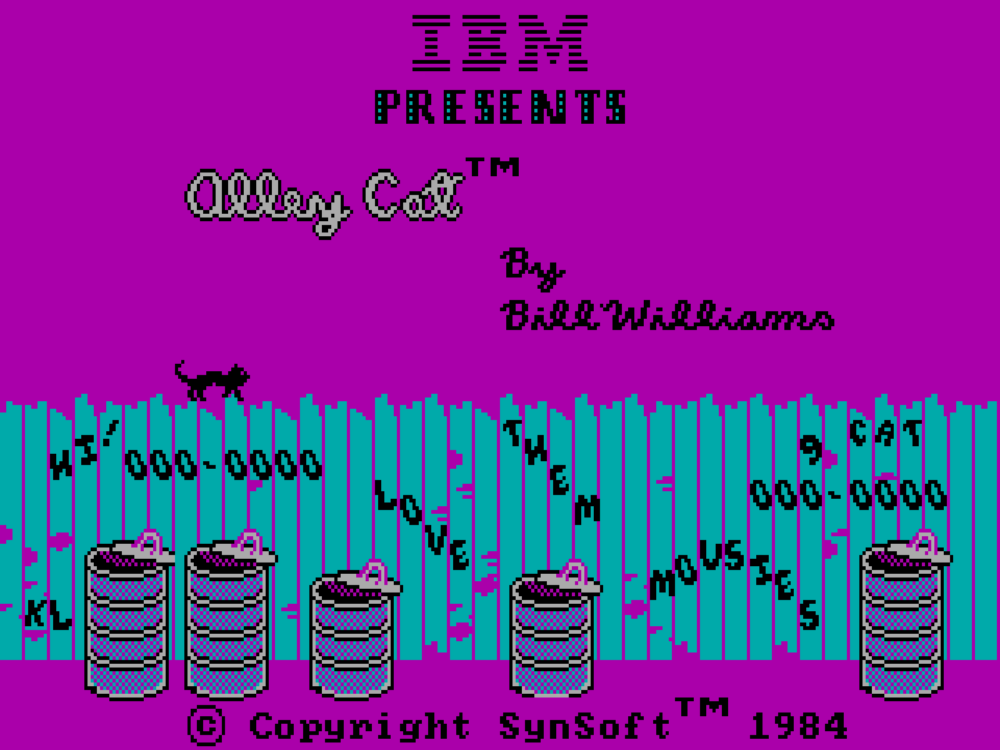](https://<USER>.github.io/<REPO>/)

## How to play

You are a black alley cat. Climb the dustbins, the fence and the washing lines, and jump in through
an open window. Behind each window is a room with a task: eat the fish in a fishbowl, steal the cheese
from the mice, take the ferns from a bookcase guarded by a spider, catch a bird, or lick the dishes
clean beside a row of sleeping bulldogs. A broom chases you round most rooms. Win a room and, back in
the alley, a lady cat calls from a window: get up through a field of hearts, past the rival cats, and
reach her. Every visit to her makes the game harder, and earns a life.

When the program starts it asks two questions. The text is the game's own:

```text
Do you want to use a joystick (Y/N)?
Please select your skill level:
   (K)itten
   (H)ouse Cat
   (T)omcat
   (A)lley Cat
During play:
   Ctrl-S  turns the sound on and off.
   Ctrl-R  restarts the game.
   Ctrl-M  returns you to this menu.
   Esc     puts the game into paws mode.
Use the cursor keys to control the cat.
The Alt key performs special actions.
Press any key to start.
```

Answer <kbd>N</kbd> (this port has no joystick), then choose a skill level.

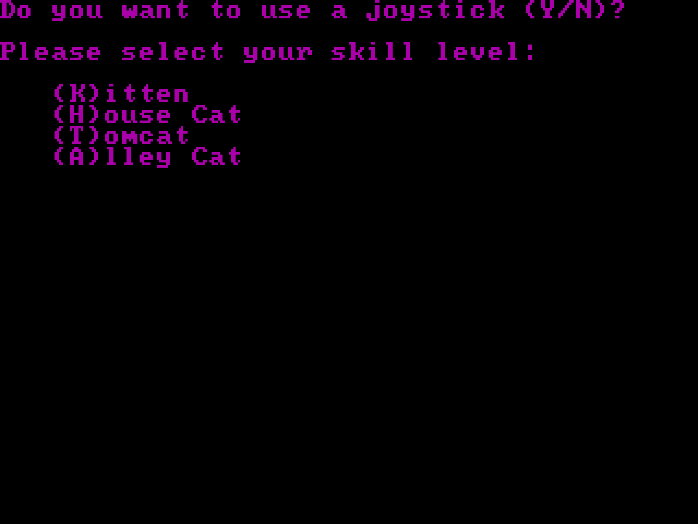

### Keys

| Key | Action |
| --- | --- |
| <kbd>←</kbd> <kbd>→</kbd> | Walk left and right |
| <kbd>↑</kbd> | Jump up (in the fishbowl: swim) |
| <kbd>↓</kbd> | Drop down from where the cat is standing (in the fishbowl: swim down) |
| <kbd>Home</kbd> <kbd>PgUp</kbd> <kbd>End</kbd> <kbd>PgDn</kbd> (or keypad 7 9 1 3) | Diagonals: up-left, up-right, down-left, down-right |
| <kbd>Alt</kbd> (or <kbd>X</kbd> in this port) | Special action: go into a mouse hole, eat from a dish, put down a gift |
| <kbd>Esc</kbd> | "Paws" the game; any key continues |
| <kbd>Ctrl</kbd>+<kbd>S</kbd> | Sound on and off |
| <kbd>Ctrl</kbd>+<kbd>R</kbd> | Restart the game |
| <kbd>Ctrl</kbd>+<kbd>M</kbd> | Back to the options menu |
| <kbd>Ctrl</kbd>+<kbd>9</kbd> | Nine lives (not mentioned in the game's own help) |
| <kbd>Ctrl</kbd>+<kbd>Y</kbd> | Quit to DOS (here: shows the DOS prompt; a key restarts) |
| <kbd>Ctrl</kbd>+<kbd>Alt</kbd>+<kbd>←</kbd>/<kbd>→</kbd> | Move the picture sideways, to centre it on your monitor |

Browsers keep some <kbd>Ctrl</kbd> combinations for themselves, so the page has buttons under the
game that send them too.

### Scoring

| What | Points |
| --- | --- |
| Catching a mouse on the top / middle / bottom washing line | 90 / 70 / 50 |
| Winning a room | 1,500 to 3,500, plus a time bonus that shrinks the longer you take |
| Reaching the lady cat | 4,000 plus a time bonus, times a multiplier of 1 to 15 that doubles if you are carrying a gift |

You start with three lives and can hold up to nine. You lose one when the dog catches you in the
alley, and when a room goes wrong (the eels, the spider, a dog waking up). Each visit to the lady cat
gives one back and raises the difficulty by one step, up to the eighth.

### Tips

- Inside a room, the broom goes after footprints. Walk along the floor to leave some and it will
  leave you alone for a while.
- The time bonus for a room starts counting when you jump in through the window: be quick.
- In the love scene, walk into a gift to pick it up, then put it down with <kbd>Alt</kbd> in a rival's
  path. Arriving with a gift still in your paws doubles the multiplier.
- A room never comes up three times in a row.

## How it works

This port was written from a disassembly of `CAT.EXE`, the PC version of the game. The disassembly
rebuilds the original program byte for byte; it names the routines and variables, but the names and
comments were written by its authors, not by the game's, so here they are only labels. Every
statement below was checked against that code, and where the port's tools could measure something
(timings, which bitmaps get drawn), it was measured.

1. [Program structure](#1-program-structure)
2. [The display: CGA mode 4](#2-the-display-cga-mode-4)
3. [Sprites and how they are drawn](#3-sprites-and-how-they-are-drawn)
4. [Sprite gallery](#4-sprite-gallery)
5. [The alley](#5-the-alley)
6. [The rooms](#6-the-rooms)
7. [The love scene](#7-the-love-scene)
8. [Difficulty](#8-difficulty)
9. [Scoring and lives](#9-scoring-and-lives)
10. [Timing](#10-timing)
11. [Randomness](#11-randomness)
12. [Sound](#12-sound)
13. [Keyboard](#13-keyboard)
14. [Quirks and curiosities](#14-quirks-and-curiosities)
15. [About this port](#15-about-this-port)

### 1. Program structure

The program is a single small DOS `.EXE`: 28,976 bytes of data (sprites, tables, text and
variables) and 25,323 bytes of code in 132 routines. It talks to the hardware directly: video
memory, the colour-select register, the programmable interval timer (PIT), the speaker port and the
keyboard interrupt. From the BIOS it uses only video services, the time-of-day tick count and the
equipment list. It never calls DOS.

At start-up it sets the 320×200 four-colour graphics mode, seeds its random number generator from
the timer chip, clears the scores and enters an endless loop of title screen, options menu, game.
A game is the alley, then the room the cat jumps into, then the alley again, until the lives run
out. The alley's main loop is short:

```text
lab_0155:  process_keyboard      Esc, Ctrl combinations
           poll_joystick         reads the cursor keys (or the joystick)
           update_animation      moves and draws the cat
           update_enemies        the dog
           -- unless the dog is on screen, the rest runs only every 4th pass --
           play_sound            background music and effects
           update_thrown_objects the washing lines
           update_cat_jump, apply_cat_gravity, animate_falling
           cycle_animations      the mice
           draw_lives
           until the cat died or went in through a window
```

Each room has a loop of the same shape with its own routines in place of the washing lines, mice
and dog. Which room comes next is decided when the cat goes in through a window; see
[the rooms](#6-the-rooms).

### 2. The display: CGA mode 4

The game uses the Color Graphics Adapter's 320×200 mode with four colours per pixel, two bits
each, four pixels to a byte. Video memory is interlaced: the even scanlines are stored first (from
offset 0), the odd ones 8 KB further on (from 0x2000), 80 bytes per line. Every drawing routine
therefore steps from one row to the next by flipping between the two halves:

```js
di ^= 0x2000;                 // next scanline is in the other half
if (!(di & 0x2000)) di += 80; // ... and one line further down every second time
```

The four colours are fixed by the hardware: colour 0 is the background colour (black, apart from
a few flashes), and colours 1 to 3 come from one of two palettes. Each screen picks its palette from a
table, `cga_palette_table` = 1, 1, 1, 1, 0, 0, 1, 0 for the alley and rooms 1 to 7.
The pixels are not square: 320×200 fills a 4:3 monitor, so each pixel is 1.2 times taller than
it is wide. The pictures here are stretched the same way (5×6 pixels for each original pixel).

| Palette | Colours 0–3 |
| --- | --- |
| Palette 0 (rooms 4, 5 and 7) |  |
| Palette 1 (title, alley, rooms 1, 2, 3 and 6) |  |
| Palette 0, bright (not used) |  |
| Palette 1, bright (not used) |  |

The 16 RGBI colours, from which the background colour and the border are chosen:


Text (the options menu, the "paws" box, the bonus figures) is printed through the BIOS, which
draws it from the 8×8 character set in the PC's system ROM. That ROM is not part of the game, so
the port carries a re-drawn copy of the standard IBM glyphs:

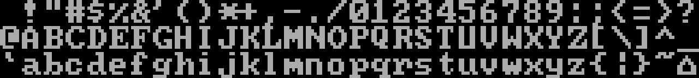

### 3. Sprites and how they are drawn

A sprite is a plain bitmap in the data segment, in the screen's own format (two bits a pixel)
but stored row after row without the interlace. Its size travels in one register, `CX`:
rows in the high byte, width in 16-bit words (8 pixels) in the low byte. Five small routines do most
of the drawing:

| Routine | What it does |
| --- | --- |
| `blit_to_cga` | Copies the bitmap to the screen as is. Used for scenery, and to erase by copying a saved background back. |
| `save_from_cga` | The reverse: copies a screen rectangle into a buffer, so it can be restored later. |
| `blit_transparent` | Draws over the background, which shows through wherever the sprite has colour 0. The background words are saved as it goes ("save-under"). |
| `blit_masked` | ANDs the sprite into the background, also saving it first. Colour 3 in the sprite leaves the background alone; colour 0 punches black. This is how the black cat is drawn. |
| `copy_with_stride` | Copies a rectangle out of a wider bitmap into a buffer. |

Moving things are erased by putting back what was under them, then redrawn at the new spot. Who
touches whom is decided almost everywhere by comparing rectangles, in one routine,
`check_rect_collision`, rather than by looking at pixels.

Scenery is mostly built from *block lists*: a word with the block size, then pairs of
(bitmap address, screen offset), ending with 0xFFFF. The rooms are not stored as maps; each one is
put together by a short routine that draws a border, a few block lists, a door frame, platforms and
single sprites at fixed screen offsets.

### 4. Sprite gallery

These are all the bitmaps the game drew while the port's extractor played through the title and
every room (177 of them, found automatically by watching which unchanging data the drawing routines
read). Each one is labelled with its offset in the data segment; the table under each sheet gives
its size, the drawing routine and the nearest label in the disassembly. Masked and transparent
sprites are shown over a grey checkerboard where they are see-through. Each group is drawn in the
palette of the screen it appears on (the page can switch palettes).

#### Title and menus (7)

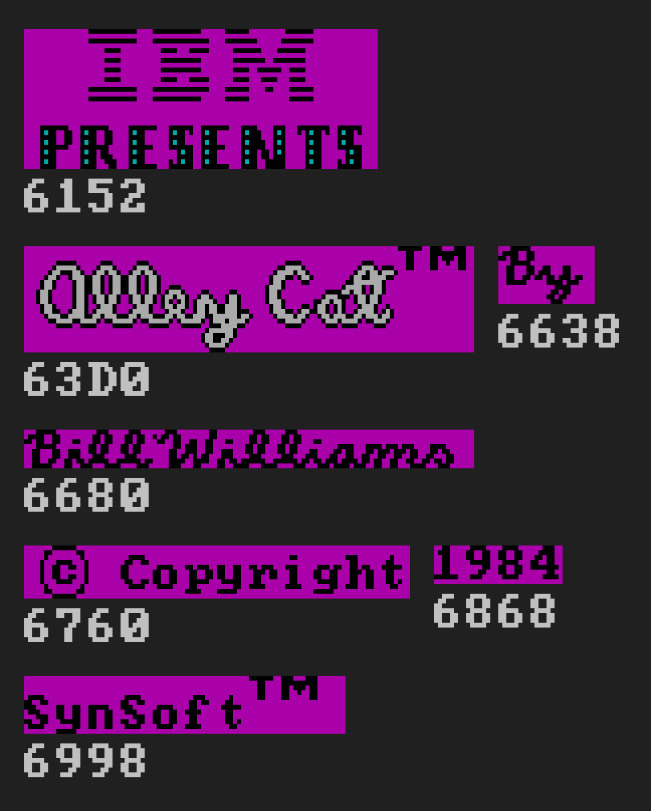

<details><summary>Offsets, sizes, drawing routine and nearest label</summary>

| Offset | Size | Drawn with | Nearest label |
| --- | --- | --- | --- |
| `6152` | 88×29 | copy | `dat_6152` |
| `63D0` | 112×22 | copy | `dat_63d0` |
| `6638` | 24×12 | copy | `dat_6638` |
| `6680` | 112×8 | copy | `dat_6680` |
| `6760` | 96×11 | copy | `dat_6760` |
| `6868` | 32×8 | copy | `dat_6868` |
| `6998` | 80×12 | copy | `dat_6868+130` |

</details>

#### Alley (38)

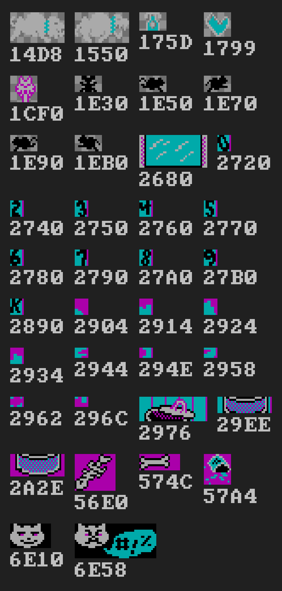

<details><summary>Offsets, sizes, drawing routine and nearest label</summary>

| Offset | Size | Drawn with | Nearest label |
| --- | --- | --- | --- |
| `14D8` | 32×15 | transparent | `keyboard_handler_xt+25` |
| `1550` | 32×15 | transparent | `keyboard_handler_pcjr+55` |
| `175D` | 16×9 | transparent | `death_sprite+e4` |
| `1799` | 16×12 | transparent | `death_sprite+120` |
| `1CF0` | 16×13 | transparent | `fall_sprite` |
| `1E30` | 16×8 | masked | `cycle_idle_sprite` |
| `1E50` | 16×8 | masked | `cycle_walk_sprite` |
| `1E70` | 16×8 | masked | `cycle_walk_sprite+20` |
| `1E90` | 16×8 | masked | `cycle_walk_sprite+40` |
| `1EB0` | 16×8 | masked | `cycle_walk_sprite+60` |
| `2680` | 40×16 | copy | `window_sprite_data` |
| `2720` | 8×8 | copy | `digit_sprites` |
| `2740` | 8×8 | copy | `digit_sprites+20` |
| `2750` | 8×8 | copy | `digit_sprites+30` |
| `2760` | 8×8 | copy | `digit_sprites+40` |
| `2770` | 8×8 | copy | `digit_sprites+50` |
| `2780` | 8×8 | copy | `digit_sprites+60` |
| `2790` | 8×8 | copy | `digit_sprites+70` |
| `27A0` | 8×8 | copy | `digit_sprites+80` |
| `27B0` | 8×8 | copy | `digit_sprites+90` |
| `2890` | 8×8 | copy | `digit_sprites+170` |
| `2904` | 8×8 | copy | `alley_base_block_list+64` |
| `2914` | 8×8 | copy | `alley_base_block_list+74` |
| `2924` | 8×8 | copy | `alley_base_block_list+84` |
| `2934` | 8×8 | copy | `alley_base_block_list+94` |
| `2944` | 8×5 | copy | `alley_base_block_list+a4` |
| `294E` | 8×5 | copy | `alley_base_block_list+ae` |
| `2958` | 8×5 | copy | `alley_base_block_list+b8` |
| `2962` | 8×5 | copy | `alley_base_block_list+c2` |
| `296C` | 8×5 | copy | `ground_extra_sprite` |
| `2976` | 40×12 | copy | `building_top_sprite` |
| `29EE` | 32×8 | copy | `building_mid_sprite` |
| `2A2E` | 32×11 | copy | `building_bottom_sprite` |
| `56E0` | 24×18 | copy | `attract_timing+6` |
| `574C` | 24×8 | copy | `attract_timing+72` |
| `57A4` | 16×15 | copy | `attract_timing+ca` |
| `6E10` | 24×12 | copy | `dat_6e10` |
| `6E58` | 48×17 | copy | `dat_6e58` |

</details>

#### The cat: walking, jumping, climbing, sitting (every screen) (29)

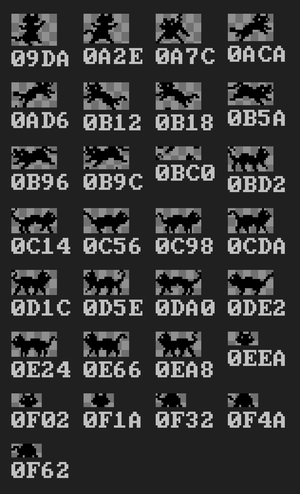

<details><summary>Offsets, sizes, drawing routine and nearest label</summary>

| Offset | Size | Drawn with | Nearest label |
| --- | --- | --- | --- |
| `09DA` | 24×14 | masked | `walk_sprite_dims+1a` |
| `0A2E` | 24×13 | masked | `walk_sprite_dims+6e` |
| `0A7C` | 24×13 | masked | `walk_sprite_dims+bc` |
| `0ACA` | 24×12 | masked | `walk_sprite_dims+10a` |
| `0AD6` | 24×11 | masked | `walk_sprite_dims+116` |
| `0B12` | 24×12 | masked | `walk_sprite_dims+152` |
| `0B18` | 24×12 | masked | `walk_sprite_dims+158` |
| `0B5A` | 24×10 | masked | `walk_sprite_dims+19a` |
| `0B96` | 24×10 | masked | `walk_sprite_dims+1d6` |
| `0B9C` | 24×10 | masked | `walk_sprite_dims+1dc` |
| `0BC0` | 24×6 | masked | `walk_sprite_dims+200` |
| `0BD2` | 24×11 | masked | `walk_sprite_dims+212` |
| `0C14` | 24×11 | masked | `walk_sprite_dims+254` |
| `0C56` | 24×11 | masked | `walk_sprite_dims+296` |
| `0C98` | 24×11 | masked | `walk_sprite_dims+2d8` |
| `0CDA` | 24×11 | masked | `walk_sprite_dims+31a` |
| `0D1C` | 24×11 | masked | `walk_sprite_dims+35c` |
| `0D5E` | 24×11 | masked | `walk_sprite_dims+39e` |
| `0DA0` | 24×11 | masked | `walk_sprite_dims+3e0` |
| `0DE2` | 24×11 | masked | `walk_sprite_dims+422` |
| `0E24` | 24×11 | masked | `walk_sprite_dims+464` |
| `0E66` | 24×11 | masked | `walk_sprite_dims+4a6` |
| `0EA8` | 24×11 | masked | `walk_sprite_dims+4e8` |
| `0EEA` | 16×6 | masked | `walk_sprite_dims+52a` |
| `0F02` | 16×6 | masked | `walk_sprite_dims+542` |
| `0F1A` | 16×6 | masked | `walk_sprite_dims+55a` |
| `0F32` | 16×6 | masked | `walk_sprite_dims+572` |
| `0F4A` | 16×6 | masked | `walk_sprite_dims+58a` |
| `0F62` | 16×6 | masked | `walk_sprite_dims+5a2` |

</details>

#### Room 1: the fishbowl room (4)

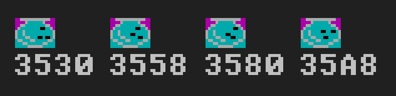

<details><summary>Offsets, sizes, drawing routine and nearest label</summary>

| Offset | Size | Drawn with | Nearest label |
| --- | --- | --- | --- |
| `3530` | 16×10 | copy | `dat_351c+14` |
| `3558` | 16×10 | copy | `dat_351c+3c` |
| `3580` | 16×10 | copy | `dat_351c+64` |
| `35A8` | 16×10 | copy | `dat_351c+8c` |

</details>

#### Room 2: inside the fishbowl (15)

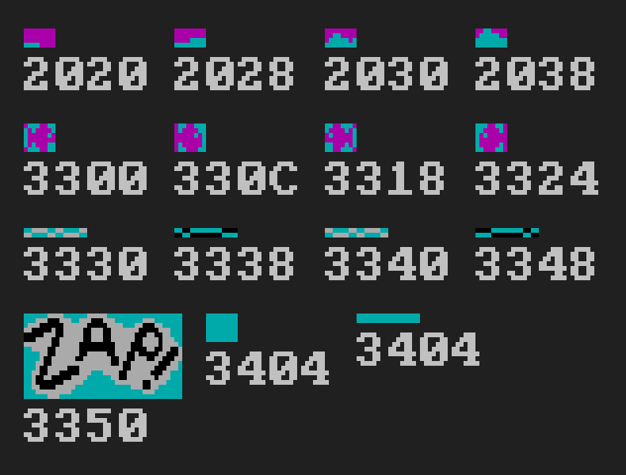

<details><summary>Offsets, sizes, drawing routine and nearest label</summary>

| Offset | Size | Drawn with | Nearest label |
| --- | --- | --- | --- |
| `2020` | 8×4 | copy | `level2_bar_sprites` |
| `2028` | 8×4 | copy | `level2_bar_sprites+8` |
| `2030` | 8×4 | copy | `level2_bar_sprites+10` |
| `2038` | 8×4 | copy | `level2_bar_sprites+18` |
| `3300` | 8×6 | copy | `l1_anim_sprite_a` |
| `330C` | 8×6 | copy | `l1_anim_sprite_a+c` |
| `3318` | 8×6 | copy | `l1_anim_sprite_a+18` |
| `3324` | 8×6 | copy | `l1_anim_sprite_a+24` |
| `3330` | 16×2 | copy | `l1_anim_sprite_b` |
| `3338` | 16×2 | copy | `l1_anim_sprite_b+8` |
| `3340` | 16×2 | copy | `l1_anim_sprite_b+10` |
| `3348` | 16×2 | copy | `l1_anim_sprite_b+18` |
| `3350` | 40×18 | copy | `l1_anim_sprite_c` |
| `3404` | 8×6 | copy | `dat_3404` |
| `3404` | 16×2 | copy | `dat_3404` |

</details>

#### The cat swimming (room 2) (11)

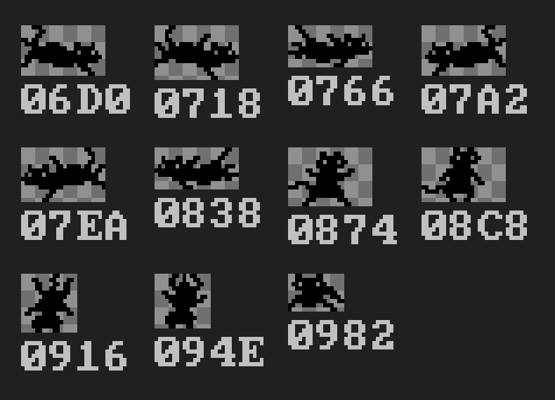

<details><summary>Offsets, sizes, drawing routine and nearest label</summary>

| Offset | Size | Drawn with | Nearest label |
| --- | --- | --- | --- |
| `06D0` | 24×12 | masked | `key_cheat+4` |
| `0718` | 24×13 | masked | `key_cheat+4c` |
| `0766` | 24×10 | masked | `key_cheat+9a` |
| `07A2` | 24×12 | masked | `key_cheat+d6` |
| `07EA` | 24×13 | masked | `key_cheat+11e` |
| `0838` | 24×10 | masked | `key_cheat+16c` |
| `0874` | 24×14 | masked | `key_cheat+1a8` |
| `08C8` | 24×13 | masked | `key_cheat+1fc` |
| `0916` | 16×14 | masked | `key_cheat+24a` |
| `094E` | 16×13 | masked | `key_cheat+282` |
| `0982` | 16×9 | masked | `key_cheat+2b6` |

</details>

#### Room 3: the bookcase (10)

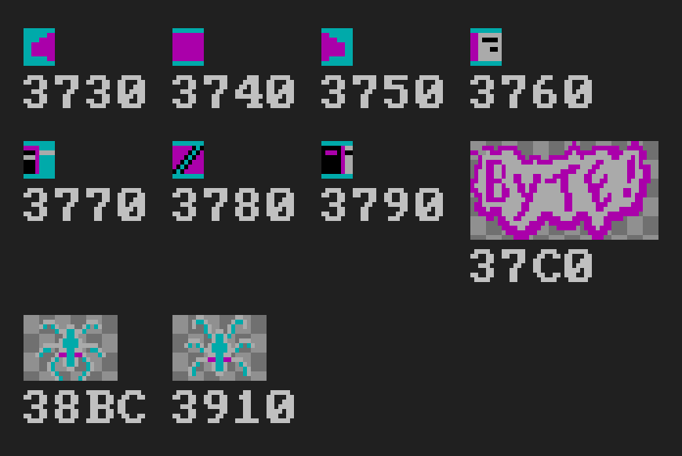

<details><summary>Offsets, sizes, drawing routine and nearest label</summary>

| Offset | Size | Drawn with | Nearest label |
| --- | --- | --- | --- |
| `3730` | 8×8 | copy | `dat_3730` |
| `3740` | 8×8 | copy | `dat_3730+10` |
| `3750` | 8×8 | copy | `dat_3730+20` |
| `3760` | 8×8 | copy | `dat_3730+30` |
| `3770` | 8×8 | copy | `dat_3730+40` |
| `3780` | 8×8 | copy | `dat_3730+50` |
| `3790` | 8×8 | copy | `dat_3730+60` |
| `37C0` | 48×21 | transparent | `dat_37c0` |
| `38BC` | 24×14 | transparent | `dat_38bc` |
| `3910` | 24×14 | transparent | `dat_38bc+54` |

</details>

#### Room 4: the cheese (15)

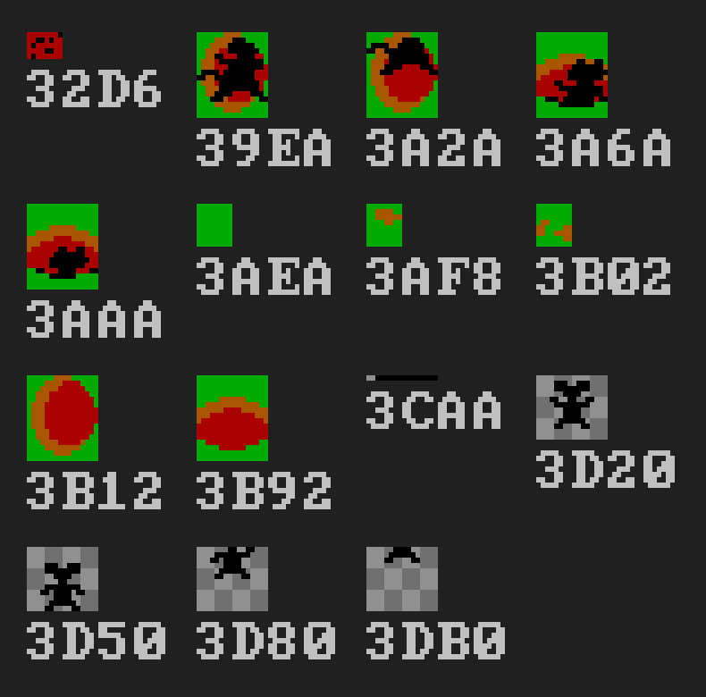

<details><summary>Offsets, sizes, drawing routine and nearest label</summary>

| Offset | Size | Drawn with | Nearest label |
| --- | --- | --- | --- |
| `32D6` | 8×5 | copy | `l1_obj_sprites+1e` |
| `39EA` | 16×16 | copy | `l3_door_sprite_base+2` |
| `3A2A` | 16×16 | copy | `l3_door_sprite_base+42` |
| `3A6A` | 16×16 | copy | `l3_door_sprite_base+82` |
| `3AAA` | 16×16 | copy | `l3_door_sprite_base+c2` |
| `3AEA` | 8×8 | copy | `dat_3aea` |
| `3AF8` | 8×8 | copy | `dat_3af8` |
| `3B02` | 8×8 | copy | `dat_3b02` |
| `3B12` | 16×16 | copy | `dat_3b02+10` |
| `3B92` | 16×16 | copy | `dat_3b02+90` |
| `3CAA` | 16×1 | masked | `dat_3caa` |
| `3D20` | 16×12 | masked | `dat_3d20` |
| `3D50` | 16×12 | masked | `dat_3d20+30` |
| `3D80` | 16×12 | masked | `dat_3d20+60` |
| `3DB0` | 16×12 | masked | `dat_3d20+90` |

</details>

#### Room 5: the birdcage (9)

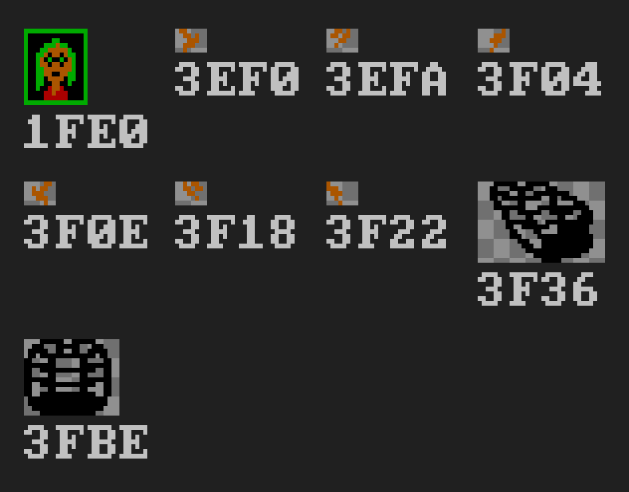

<details><summary>Offsets, sizes, drawing routine and nearest label</summary>

| Offset | Size | Drawn with | Nearest label |
| --- | --- | --- | --- |
| `1FE0` | 16×16 | copy | `level5_door_sprite` |
| `3EF0` | 8×5 | transparent | `l5_save_buf_ptrs+12` |
| `3EFA` | 8×5 | transparent | `l5_save_buf_ptrs+1c` |
| `3F04` | 8×5 | transparent | `l5_save_buf_ptrs+26` |
| `3F0E` | 8×5 | transparent | `l5_save_buf_ptrs+30` |
| `3F18` | 8×5 | transparent | `l5_save_buf_ptrs+3a` |
| `3F22` | 8×5 | transparent | `l5_save_buf_ptrs+44` |
| `3F36` | 32×17 | masked | `dat_3f36` |
| `3FBE` | 24×16 | masked | `dat_3fbe` |

</details>

#### Room 6: the sleeping dogs (15)

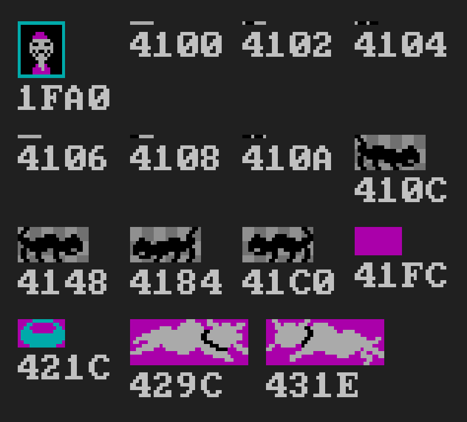

<details><summary>Offsets, sizes, drawing routine and nearest label</summary>

| Offset | Size | Drawn with | Nearest label |
| --- | --- | --- | --- |
| `1FA0` | 16×16 | copy | `level6_door_sprite` |
| `4100` | 8×1 | copy | `dat_4100` |
| `4102` | 8×1 | copy | `dat_4100+2` |
| `4104` | 8×1 | copy | `dat_4100+4` |
| `4106` | 8×1 | copy | `dat_4100+6` |
| `4108` | 8×1 | copy | `dat_4100+8` |
| `410A` | 8×1 | copy | `dat_4100+a` |
| `410C` | 24×10 | masked | `dat_4100+c` |
| `4148` | 24×10 | masked | `dat_4100+48` |
| `4184` | 24×10 | masked | `dat_4100+84` |
| `41C0` | 24×10 | masked | `dat_4100+c0` |
| `41FC` | 16×8 | copy | `l5_sprite_table_base` |
| `421C` | 16×8 | copy | `l5_sprite_table_base+20` |
| `429C` | 40×13 | copy | `l5_sprite_table_base+a0` |
| `431E` | 40×13 | copy | `l5_sprite_table_base+122` |

</details>

#### Room 7: the love scene (16)

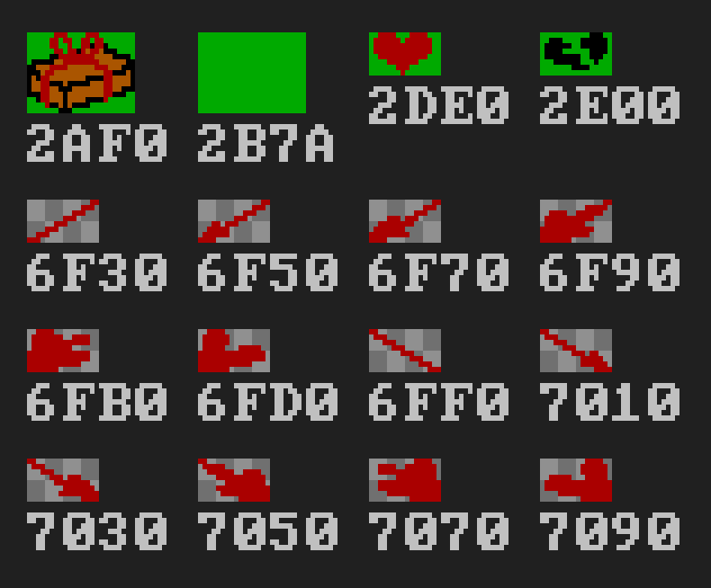

<details><summary>Offsets, sizes, drawing routine and nearest label</summary>

| Offset | Size | Drawn with | Nearest label |
| --- | --- | --- | --- |
| `2AF0` | 24×15 | copy | `l7_obj_sprite` |
| `2B7A` | 24×15 | copy | `l7_obj_erase_sprite` |
| `2DE0` | 16×8 | copy | `window_open_state+1fe` |
| `2E00` | 16×8 | copy | `window_open_state+21e` |
| `6F30` | 16×8 | transparent | `dat_6f30` |
| `6F50` | 16×8 | transparent | `dat_6f30+20` |
| `6F70` | 16×8 | transparent | `dat_6f30+40` |
| `6F90` | 16×8 | transparent | `dat_6f30+60` |
| `6FB0` | 16×8 | transparent | `dat_6f30+80` |
| `6FD0` | 16×8 | transparent | `dat_6f30+a0` |
| `6FF0` | 16×8 | transparent | `dat_6f30+c0` |
| `7010` | 16×8 | transparent | `dat_6f30+e0` |
| `7030` | 16×8 | transparent | `dat_6f30+100` |
| `7050` | 16×8 | transparent | `dat_6f30+120` |
| `7070` | 16×8 | transparent | `dat_6f30+140` |
| `7090` | 16×8 | transparent | `dat_6f30+160` |

</details>

#### Shared by several rooms (8)

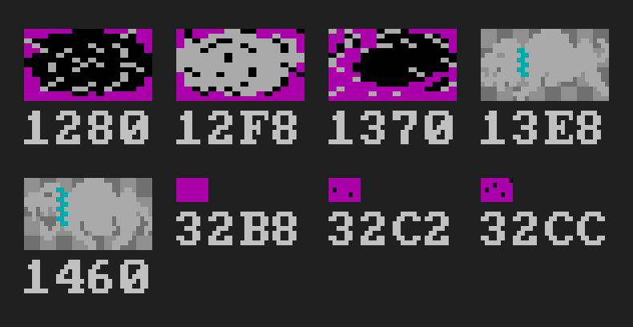

<details><summary>Offsets, sizes, drawing routine and nearest label</summary>

| Offset | Size | Drawn with | Nearest label |
| --- | --- | --- | --- |
| `1280` | 32×15 | copy | `door_contact+4` |
| `12F8` | 32×15 | copy | `dat_12e7+11` |
| `1370` | 32×15 | copy | `meow_sound_data+5e` |
| `13E8` | 32×15 | transparent | `meow_sound_data+d6` |
| `1460` | 32×15 | transparent | `current_score_cga_pos+24` |
| `32B8` | 8×5 | copy | `l1_obj_sprites` |
| `32C2` | 8×5 | copy | `l1_obj_sprites+a` |
| `32CC` | 8×5 | copy | `l1_obj_sprites+14` |

</details>

### 5. The alley

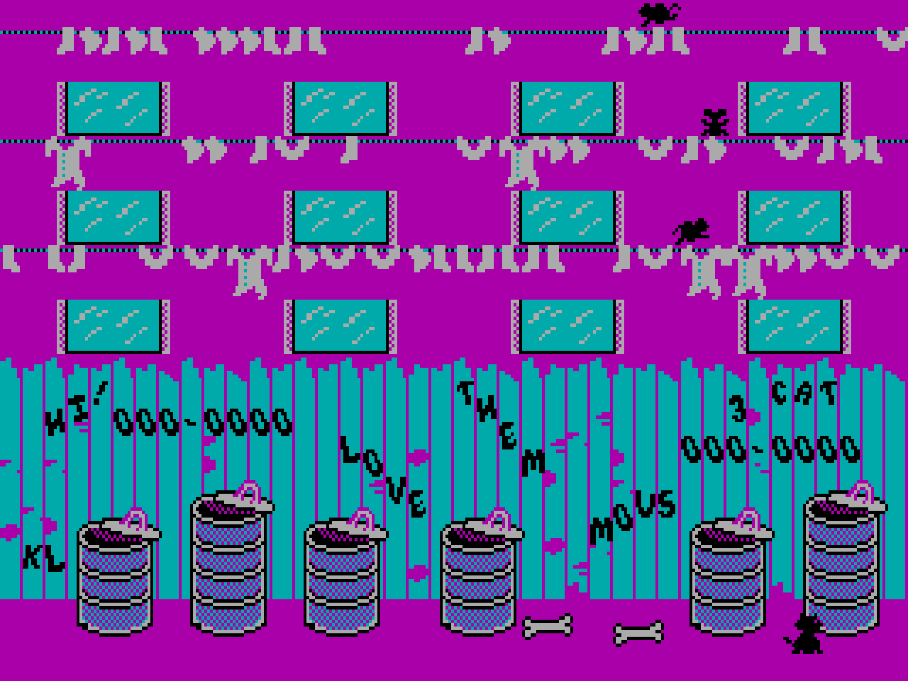

*The alley, drawn by the port's engine.*

The alley is one screen: three washing lines across the top with rows of windows between them,
a fence, a row of dustbins and the pavement. The background is drawn once per visit, partly at
random (a row of ground tiles and a few small details are picked by the random number generator,
so no two alleys look quite alike).

**The washing lines** scroll sideways one byte, four pixels, at a time: the routine moves the
whole 8-line band of video memory with a single string-move instruction and feeds a new column of
laundry in at the edge. Each new stretch of line is either bare or carries a shirt or random
garments; the chance of bare line depends on the difficulty. A cat standing on laundry is carried
four pixels per step and drops off at the end of the line. The lines step faster while the cat is up
high.

**The mice**: three, one on each washing line. Each wanders, turns at random, and if it is
level with the cat may run straight at it. A mouse that runs into a cat standing on something knocks
it off; a cat leaping into a mouse catches it, scores, and the mouse comes back from the far side
about three seconds later.

**The dog** only appears while the cat is down on the ground. Every check there is a small
chance it comes running in from the side; while it runs it may turn towards the cat, and if it reaches
it the two disappear into a fight and the cat loses a life.

**The windows** open one at a time; jumping into the open one starts a room. A bottom-row
window next to a dustbin whose lid has popped off does not open. Things are also thrown out of the
windows: one that hits the cat knocks it off whatever it was standing on.

### 6. The rooms

When the cat goes in through a window the program picks a room. Three times in four (when the
random number has either of bits 5 and 7 set) it takes one of four entries from a row of
`level_pool` chosen by the difficulty; otherwise, and always at difficulty 3 and 7, it
takes one of the five entries of `level_pool_hard`. A choice equal to *both* of the
last two rooms is drawn again, so no room comes up three times running.

| `difficulty_level & 3` | `level_pool` row (3 draws in 4) | otherwise |
| ---: | --- | --- |
| 0 | 4, 4, 1, 1 | `level_pool_hard`: 1, 3, 4, 5, 6 |
| 1 | 3, 3, 5, 5 | `level_pool_hard`: 1, 3, 4, 5, 6 |
| 2 | 6, 6, 4, 1 | `level_pool_hard`: 1, 3, 4, 5, 6 |
| 3 | (never used) | `level_pool_hard`: 1, 3, 4, 5, 6 |

Room 2 is never drawn: it is the inside of the fishbowl in room 1. Room 7 is never drawn either;
it follows a won room (see [the love scene](#7-the-love-scene)).

<table>
<tr>
<td width="50%">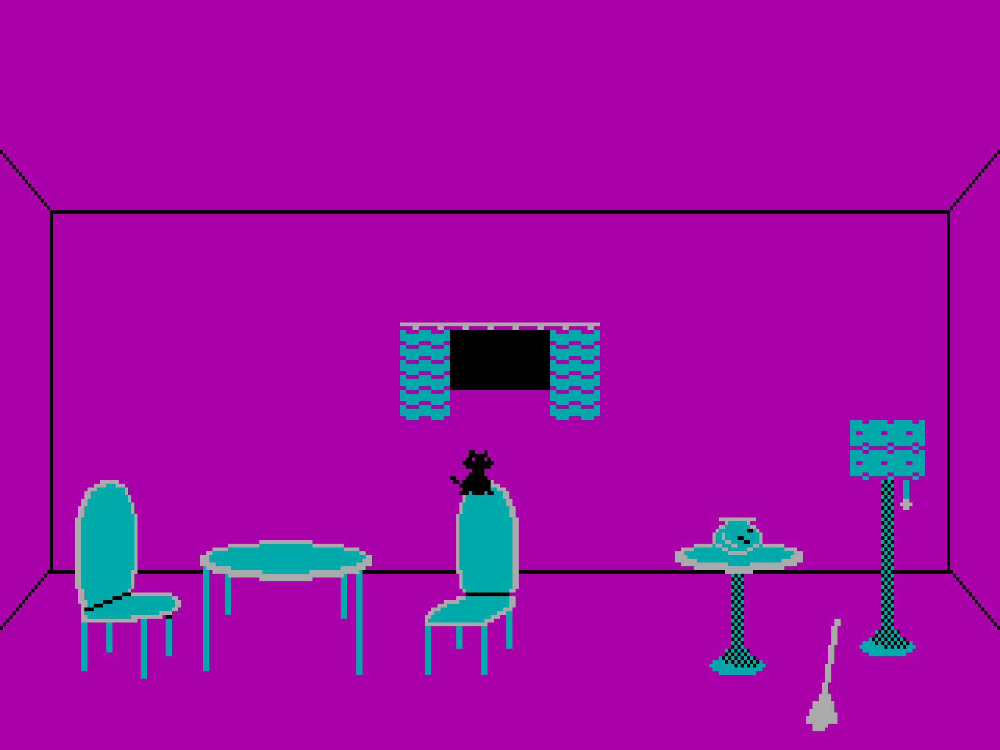<br><b>Room 1, the fishbowl room.</b> Jump into the bowl on the little table to go into room 2.</td>
<td width="50%">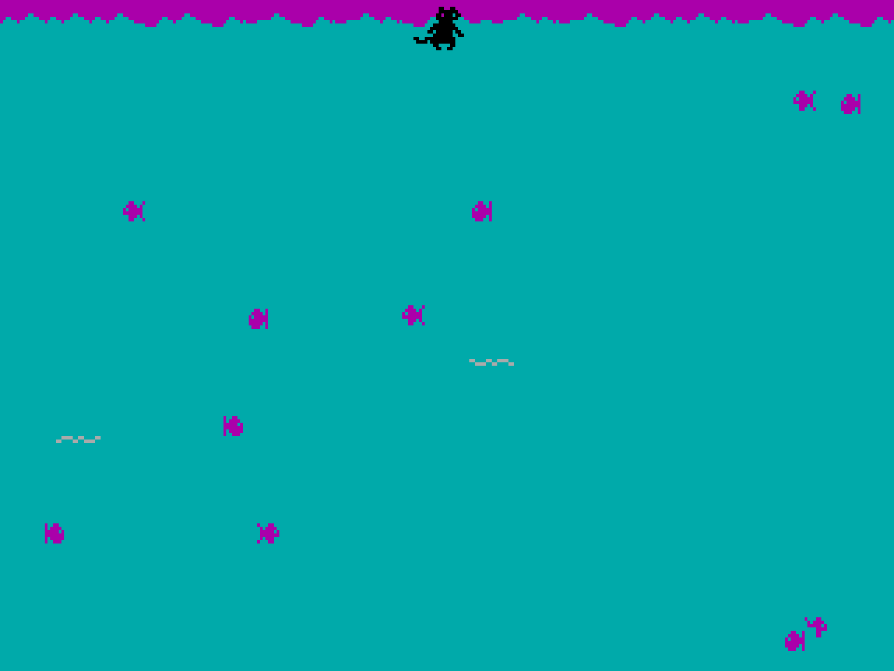<br><b>Room 2, inside the fishbowl.</b> Eat the fish (magenta); keep away from the eels.</td>
</tr>
<tr>
<td>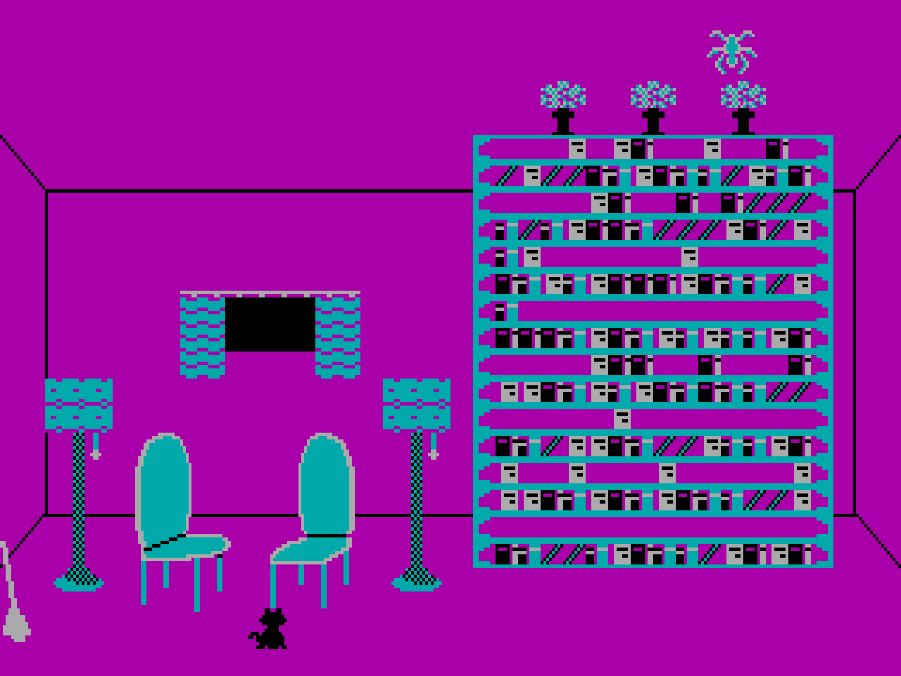<br><b>Room 3, the bookcase.</b> Climb the shelves for the three ferns on top, under the spider.</td>
<td>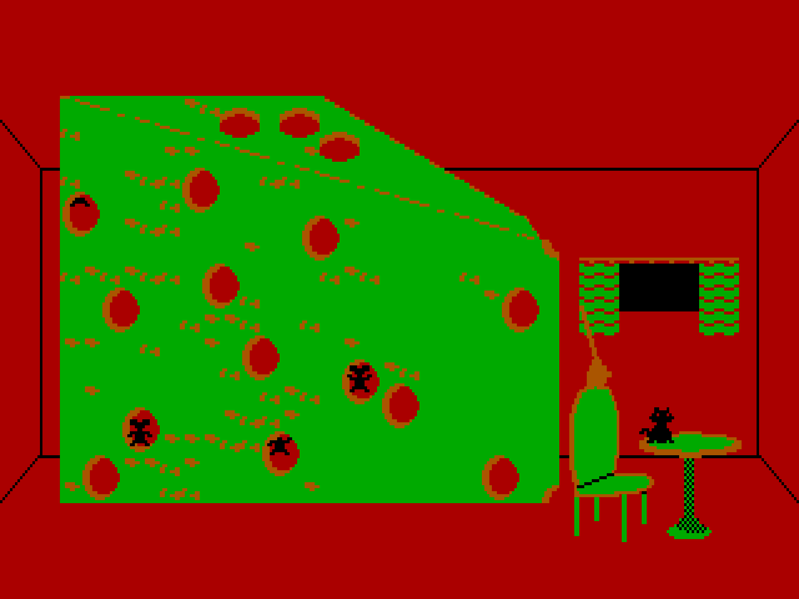<br><b>Room 4, the cheese.</b> Mice look out of the holes; <kbd>Alt</kbd> in front of a hole goes in after one.</td>
</tr>
<tr>
<td>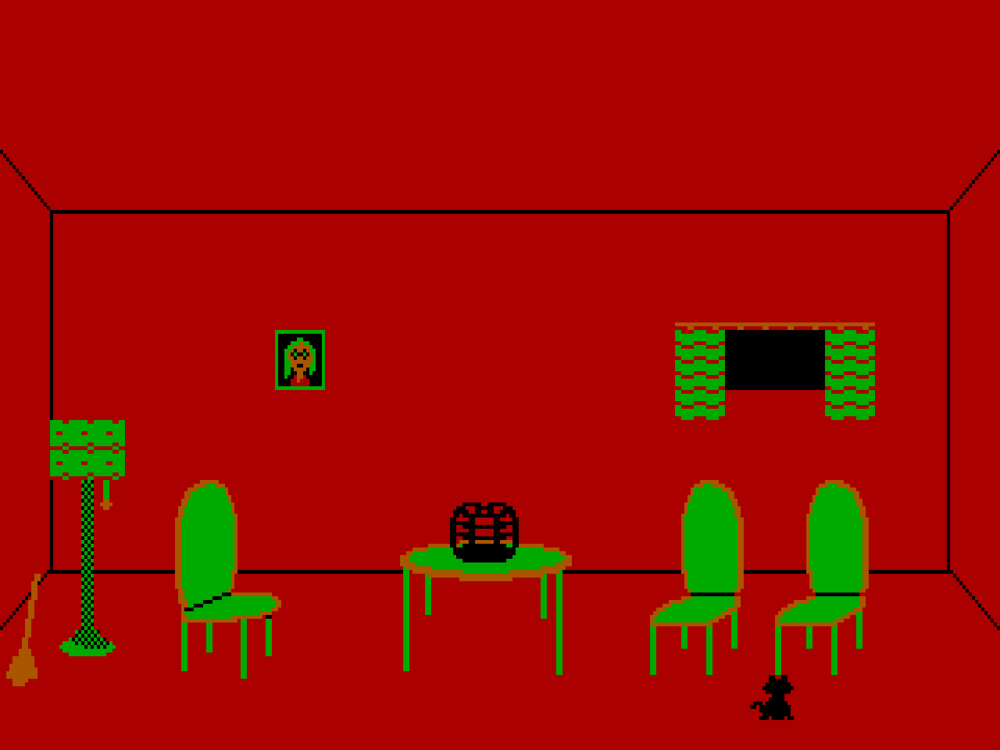<br><b>Room 5, the birdcage.</b> Push the cage off the table, then catch the bird.</td>
<td>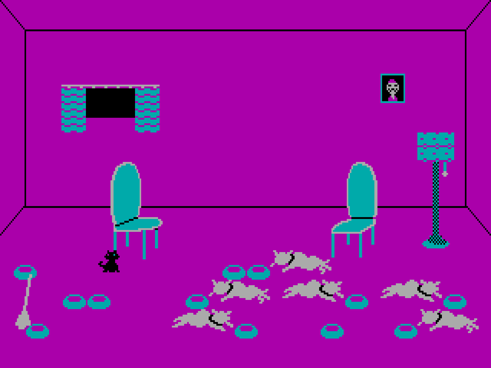<br><b>Room 6, the sleeping dogs.</b> Hold <kbd>Alt</kbd> to walk to the nearest dish and eat. Empty all twelve without waking a dog.</td>
</tr>
</table>

In most rooms a broom sweeps around after the cat. The cat's footprints along the floor
distract it.

### 7. The love scene

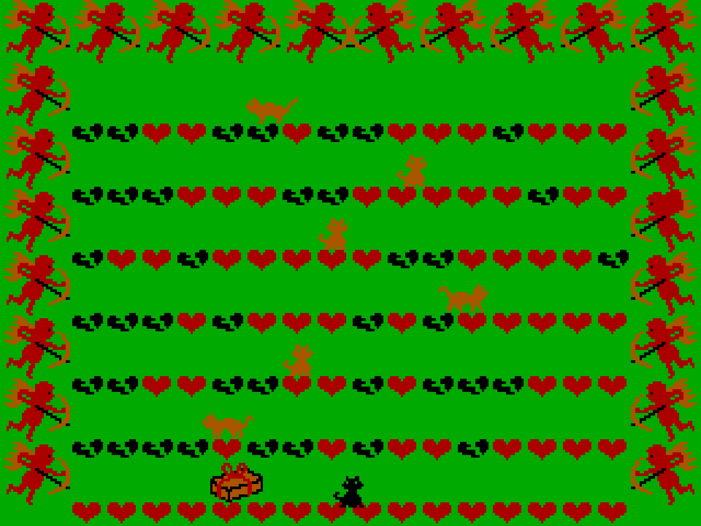

*Room 7: rows of hearts inside a border of cupids, rival cats on the rows.*

After a room is won the next window leads here (`force_level7`). Seven rows of
16 hearts are drawn, each one whole or broken at random, except the bottom row, which is always
whole. The cat can stand only on whole hearts. A cupid flies in from a side or from the top and
moves diagonally down the screen, one step per tick; every heart it passes flips between whole and
broken, and if it touches the cat it knocks it down. Rival cats walk the rows and knock the cat down
when they touch it. The cat in the top row is the lady cat: touching her wins.

On the bottom row lie as many gifts as rooms won since the last visit (at least one, at most
eight). Walking into a gift picks it up, and the background turns blue while the cat carries it;
<kbd>Alt</kbd> puts it down on the nearest row, unless it would overlap another gift.

Reaching the lady cat plays the victory sequence, adds a life (up to nine) and raises the
difficulty by one, up to 7.

### 8. Difficulty

One variable, `difficulty_level`, drives everything. A new game starts it at the
chosen skill (Kitten 0, House Cat 1, Tomcat 2, Alley Cat 3), and each visit to the lady cat adds
one, up to 7. Tables of eight bytes indexed by it set the odds:

| Table | Meaning | 0 | 1 | 2 | 3 | 4 | 5 | 6 | 7 |
| --- | --- | ---: | ---: | ---: | ---: | ---: | ---: | ---: | ---: |
| `throw_delay` | Washing lines: loop passes between steps (a quarter of this while the cat is up high) | 100 | 80 | 70 | 60 | 55 | 50 | 40 | 40 |
| `throw_chance` | Washing lines: chance in 256 that a new stretch of line is bare | 6 | 20 | 32 | 46 | 46 | 52 | 58 | 64 |
| `enemy_spawn_chance` | Dog: chance in 256, per check, that it comes running | 2 | 4 | 8 | 12 | 16 | 24 | 32 | 64 |
| `enemy_chase_chance` | Dog: chance in 256 that it turns towards the cat | 16 | 32 | 48 | 64 | 80 | 96 | 112 | 128 |
| `obj_chase_table` | Mice: chance in 256 that a mouse level with the cat runs at it | 8 | 32 | 64 | 128 | 160 | 192 | 208 | 240 |
| `l6_obj_type` | Room 6: number of sleeping dogs | 6 | 6 | 7 | 7 | 8 | 8 | 9 | 9 |
| `l6_obj_init_y_tbl` | Room 6: helpings in each dish | 1 | 2 | 3 | 4 | 4 | 4 | 4 | 4 |
| `0x36DC` | Love scene bonus multiplier (doubled when carrying a gift) | 1 | 3 | 5 | 7 | 9 | 11 | 13 | 15 |

### 9. Scoring and lives

Scores are kept as seven unpacked decimal digits, one per byte, and added with the processor's
decimal-adjust instruction (`AAA`). The high score lives only in memory; there is no
score file, so it is cleared every time the program starts.

A mouse adds 9, 7 or 5 (from `obj_score`) to the second-last digit. That adding routine
carries only upwards from there, so mice can never change the last digit.

Winning a room adds a base bonus plus a time bonus counted from the moment the cat jumped in
through the window. The time bonus never goes below zero:

| Room | Base bonus | Time bonus (t = ticks since entering, 18.2 per second) |
| --- | ---: | --- |
| Room 2: inside the fishbowl | 3,000 | 2 × (1,350 − t) |
| Room 3: the bookcase | 2,000 | 2 × (1,350 − t) |
| Room 4: the cheese | 1,500 | 2 × (1,350 − t) |
| Room 5: the birdcage | 3,500 | 2 × (1,350 − t) |
| Room 6: the sleeping dogs | 2,500 | 2,700 − t |
| Room 7: the love scene | 4,000 | (10,800 − t) ÷ 2, t counted from the start of the game or the last love scene; then × multiplier |

For the love scene the sum is then added to the score once per multiplier step: the multiplier is
1, 3, 5 … 15 by difficulty, doubled if the cat arrives carrying a gift, and is printed on screen as
`BONUS MULTIPLIER: nn`.

Lives: three at the start of a game, at most nine. One is lost when the dog catches the cat in
the alley, and one when a room ends badly. Each visit to the lady cat gives one back.

### 10. Timing

There is no frame rate. The loops run as fast as the 4.77 MHz processor allows, and the game keeps
its pace by looking at three clocks: the BIOS tick count (18.2 per second), the timer chip's
counter, and the CGA's vertical-retrace bit. Most moving things act only when the tick count has
changed since their last move, or every so many ticks; the rest simply run once per loop. The routine
that reads the keys does not run on every pass of the loop either: it acts only when the tick count
has moved on by two.

Because the routines that are not tied to the tick count run once per pass, the game's feel
depends on how long each pass takes, which in turn depends on how much there is to draw. In the
alley that is visible: with the dog on screen everything runs on every pass, without it most of the
loop runs every fourth.

### 11. Randomness

The random numbers come from a 16-bit shift register. Each call shifts the seed right by one and
feeds in, at the top, bit 1 of the low byte XORed with the high byte:

```js
fb   = ((seed & 0xff) ^ (seed >> 8)) >> 1 & 1;
seed = (seed >> 1) | (fb << 15);
```

It is seeded once, at start-up, from the timer chip's running counter, read low byte then high
byte but stored the other way round. A seed of zero would stick at zero, so it is replaced by
0xFA59.

### 12. Sound

All sound comes from the PC speaker. Two techniques are used:

- **Tones**: channel 2 of the timer chip is programmed (ports 0x43 and 0x42) to divide its
  1.19 MHz clock by a 16-bit number, giving a square wave, and bits 0 and 1 of port 0x61 connect it
  to the speaker. Music and most effects are tables of such divisors with durations measured in BIOS
  ticks or by polling the timer.
- **Noise**: some effects give the timer a new random divisor every tick, or every time its
  counter moves; others disconnect the timer and toggle the speaker bit directly, following a bit
  pattern.

The background music is played a note at a time from inside the main loop, with no interrupt
involved: each pass checks whether the current note has lasted long enough.

### 13. Keyboard

The game replaces the keyboard interrupt with its own handler. For every key event it bumps a
counter (any key press counts as "a key") and, if the scan code is one of 22 it cares about,
records whether that key is up or down. Esc, the cursor keys, the four diagonal keys, Alt, Ctrl, and
a handful of letters and digits are in that list; Ctrl+Alt+Del is checked by the handler itself.

### 14. Quirks and curiosities

- **Nine lives.** Ctrl+9 sets the lives to nine at any time. Neither it nor Ctrl+Y (quit to DOS)
  appears in the game's own list of keys.
- **"Paws mode".** The pause box really reads `Paws Game:`. Pausing puts the tick count
  back afterwards, so tick-based timers ignore the pause.
- **A delay that isn't.** After reading the keys, `poll_joystick` waits for the timer
  counter to move by a large amount, but the test is written so that it is satisfied as soon as the
  counter has moved at all, a few microseconds later.
- **The dog speeds things up.** In the alley, the music, washing lines, jumping and mice only run
  every fourth pass of the loop, unless the dog is on screen.
- **Picture position.** Ctrl+Alt+Left/Right reprogram the CRTC's horizontal-sync register
  (0x27 plus a number from 0 to 7) to slide the picture sideways. The disassembly calls that number
  `video_mode`.
- **PCjr support.** The program checks the machine ID byte at F000:FFFE. On a PCjr (0xFD) it skips
  the diagonal keys and the colour-select port, and the picture offset differs.
- **Never thrice.** A room is redrawn only if it equals both of the two previous rooms, so the
  same room can come twice in a row but never three times.
- **Rooms that never come up by chance.** Rooms 2 and 7 are not in either room pool.

### 15. About this port

The port keeps the original's memory: all game state lives in a copy of the 64 KB data segment,
at the same offsets, and the JavaScript routines have the same names as the disassembly's, so the
two can be read side by side. Video memory is emulated byte for byte and the original drawing
routines are ported against it, so erase artefacts and overlaps come out the same.

Timing is reproduced with a virtual clock: every routine adds the processor cycles it took on the
original, the tick count, timer counter and retrace bit are computed from that clock, and the game
sleeps whenever it gets ahead of real time. The cycle costs were measured by running the original
program in an 8088 and PC emulator written for this port, and the loop rates of the port were
compared against it room by room (they agree to within about 10%).

| File | Contents |
| --- | --- |
| `index.html` | The page: the game, how to play, and this write-up. |
| `js/assets.js` | Generated: the original data and code segments, labels, and the sprite catalogue. |
| `js/cga.js` | Emulated CGA memory and palette, BIOS text output, the drawing routines. |
| `js/sound.js` | The timer channel 2 and speaker, rendered from timestamped port writes. |
| `js/game.js` | The game, routine by routine, on the virtual clock. |
| `js/main.js` | Page glue: canvas, keys, overlay, controls. |
| `js/docs.js` | Builds the page's galleries and tables from the original data. |
| `tools/` | Node scripts: data extractor, headless runner, image renderers, PNG encoder, the reference emulator. |
| `img/`, `readme-img/` | Pre-rendered pictures for the page and for this README. |

Deliberate differences from the original:

- The 8×8 text font is a re-drawn copy of the IBM ROM font, which is not part of the game.
- No joystick. Answering Y in the menu shows the game's own "joystick is not attached" message.
- <kbd>X</kbd> works as a second <kbd>Alt</kbd>, and the buttons under the game send the Ctrl
  combinations, because browsers keep some of those keys.
- Ctrl+Y shows a DOS prompt and restarts the program on the next key; Ctrl+Alt+Del restarts it
  instead of rebooting the computer.
- Timing comes from measured cycle costs rather than a cycle-exact processor, so it is close but
  not identical; the speed control scales the whole machine, timer chip included, so it also raises
  the pitch of the sound.
- The program starts instantly instead of after DOS has loaded it.
- The sound is lightly filtered (a low-pass filter and a DC blocker) to soften the speaker's square
  waves.

## Regenerating the data and pictures

Everything generated is reproducible with Node.js alone (no packages):

```sh
node tools/extract.js                               # js/assets.js from the disassembly
node tools/render-docs.js && node tools/render-readme.js   # img/ and readme-img/
```

`render-readme.js` also writes the Markdown for this README's sprite tables, difficulty, room pool
and bonus tables to `tools/out/readme-tables.md`.

---

Alley Cat © 1984 Synapse Software / IBM. This is a fan port for study and play.
